<div align="center">


### Ceritain mood-mu, biar lagunya yang ngerti.

Ketik apa yang lagi kamu rasain, dan feelist menyusun playlist yang pas: bisa digeser dari sendu sampai ceria,
dibagikan jadi kartu Story, dan dirangkum tiap bulan seperti *Wrapped* versimu sendiri.


-8E75B2?logo=googlegemini&logoColor=white)


[Fitur](#-fitur) · [Tangkapan layar](#-tangkapan-layar) · [Mulai](#-mulai-cepat) · [Deploy](#-deploy-ke-vercel) · [Cara kerja](#-cara-kerja) · [Struktur](#-struktur-folder)

<br />

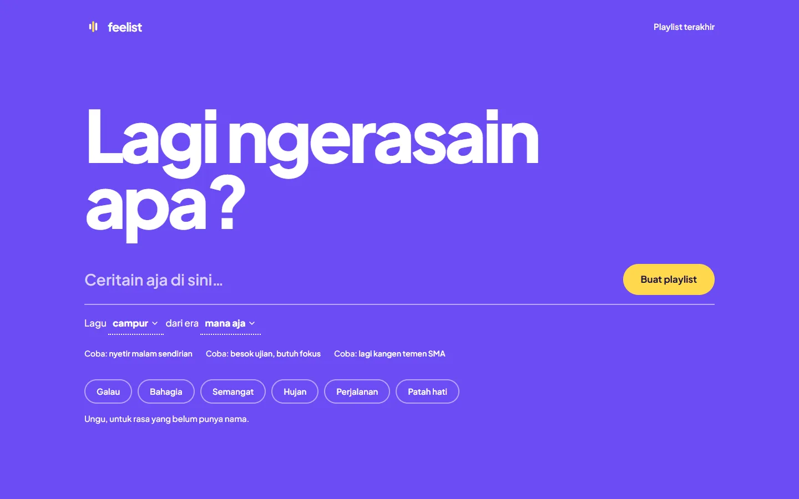
&nbsp;
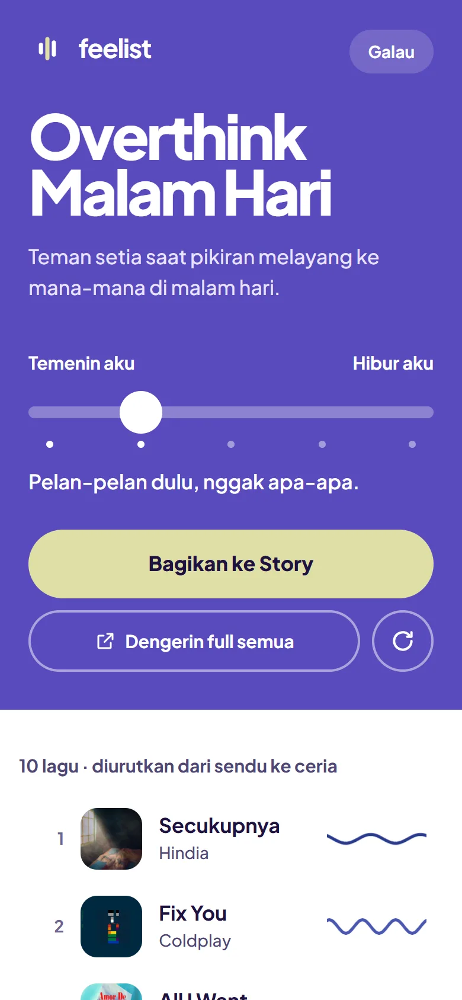

</div>

---

## Daftar isi

- [Tentang](#-tentang)
- [Sorotan](#-sorotan)
- [Tangkapan layar](#-tangkapan-layar)
- [Fitur](#-fitur)
- [Cara kerja](#-cara-kerja)
- [Tech stack](#-tech-stack)
- [Mulai cepat](#-mulai-cepat)
- [Deploy ke Vercel](#-deploy-ke-vercel)
- [Struktur folder](#-struktur-folder)
- [Kustomisasi](#-kustomisasi)
- [Kualitas & pengujian](#-kualitas--pengujian)
- [Privasi](#-privasi)
- [Batas beban](#-batas-beban)
- [Catatan](#-catatan)
- [Troubleshooting](#-troubleshooting)

## 💜 Tentang

**feelist** adalah web app (PWA) yang mengubah cerita perasaan, misalnya _"galau habis UTS tapi pengen semangat lagi"_, jadi playlist.

- Rekomendasi lagu dibuat oleh AI: **Gemini** (gratis lewat free tier Google AI Studio) atau **Claude** (opsional, berbayar).
- Setiap lagu dicocokkan ke **Deezer** untuk mengambil cover album, preview audio 30 detik, durasi, dan link.
- Semua riwayat dan rangkuman disimpan **di perangkat pengguna sendiri**, tanpa login dan tanpa database.

## ✨ Sorotan

| | |
| --- | --- |
| 🎚️ **Geser mood** | Satu slider 5 tingkat, dari *"Temenin aku"* sampai *"Hibur aku"*. Daftar lagu, warna, dan gelombang suaranya berubah realtime tanpa memanggil AI lagi. |
| 🃏 **21 kartu Story** | Kartu 1080×1920 siap Instagram dalam 4 kategori (Seru, Ngobrol, Kalcer, Lokal), dengan rekomendasi gaya sesuai mood. |
| 📼 **Rangkuman bulanan** | 9 slide ala Story: angka, kuis, mood, kalender rasa, jam favorit, lagu teratas, dan tipe pendengar. 12 edisi, satu gaya untuk tiap bulan. |
| 🗂️ **Playlist terakhir** | 50 playlist tersimpan di IndexedDB. Bisa dibuka ulang tanpa memanggil AI, bahkan saat offline. |
| 📱 **PWA & offline** | Bisa di-install ke layar utama, dan halaman, font, serta cover lagu tetap tersedia tanpa internet. |
| ♿ **Aksesibel** | Bisa dipakai penuh dengan keyboard, kontras teks ≥ 4.5:1 di semua mood, 0 pelanggaran axe, Lighthouse aksesibilitas 100. |

## 📸 Tangkapan layar

### Beranda

Cukup ceritakan rasamu, atau ketuk chip mood. Bahasa dan era lagu dipilih lewat satu kalimat interaktif: *"Lagu **campur** dari era **mana aja**"*.

<p align="center">
  
  &nbsp;
  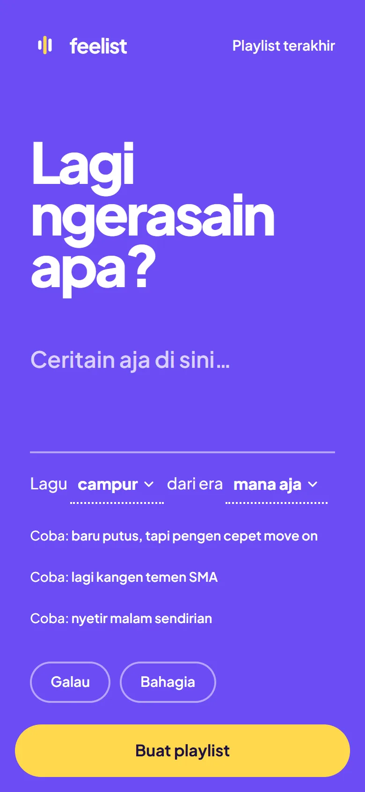
</p>

### Hasil & Geser mood

Panel kiri berwarna mood, sedangkan daftar lagu ada di kanan dengan indikator gelombang suara per lagu. Pemutar menempel di bawah, lengkap dengan tombol sebelumnya/berikutnya dan *Dengerin full* (Spotify / YouTube Music).

<p align="center">
  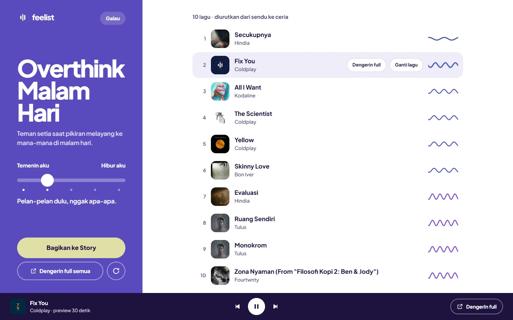
</p>

Geser slider-nya, dan urutan lagu, warna panel, serta gelombangnya langsung berubah:

<p align="center">
  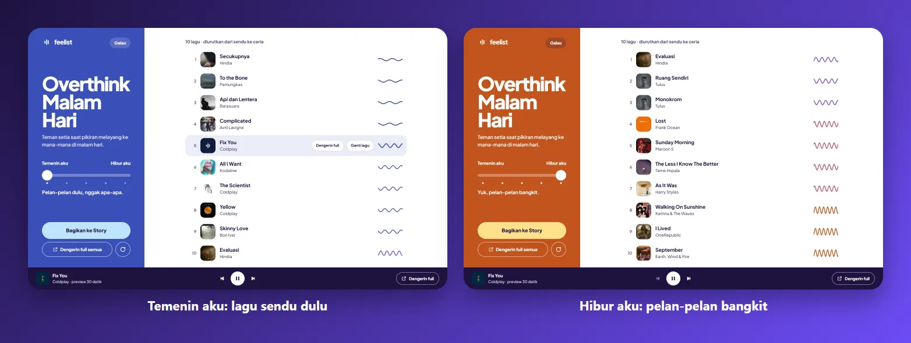
</p>

### Kartu Story

Pilih gaya kartu dari 21 template. Thumbnail dirender langsung dari playlist-mu, lalu tinggal bagikan ke Story atau simpan gambarnya.

<p align="center">
  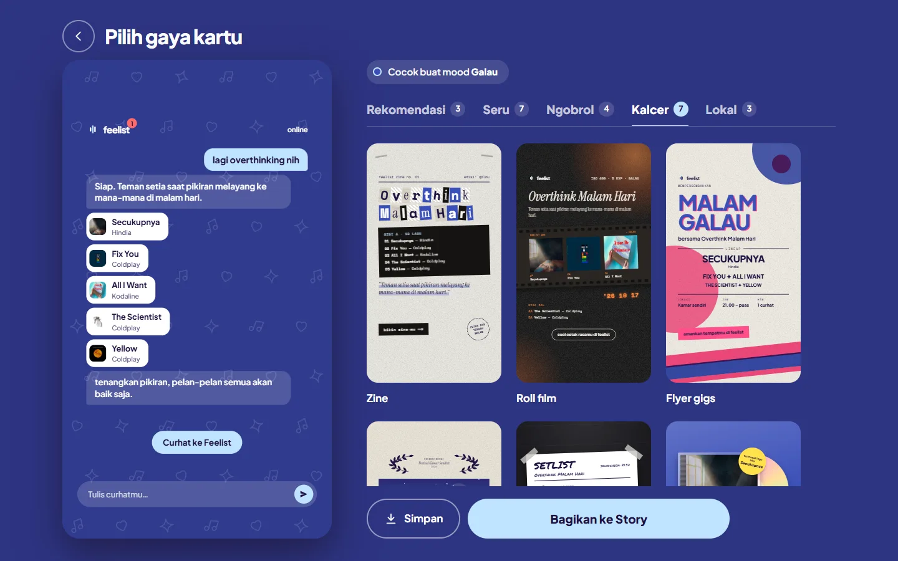
</p>

<p align="center">
  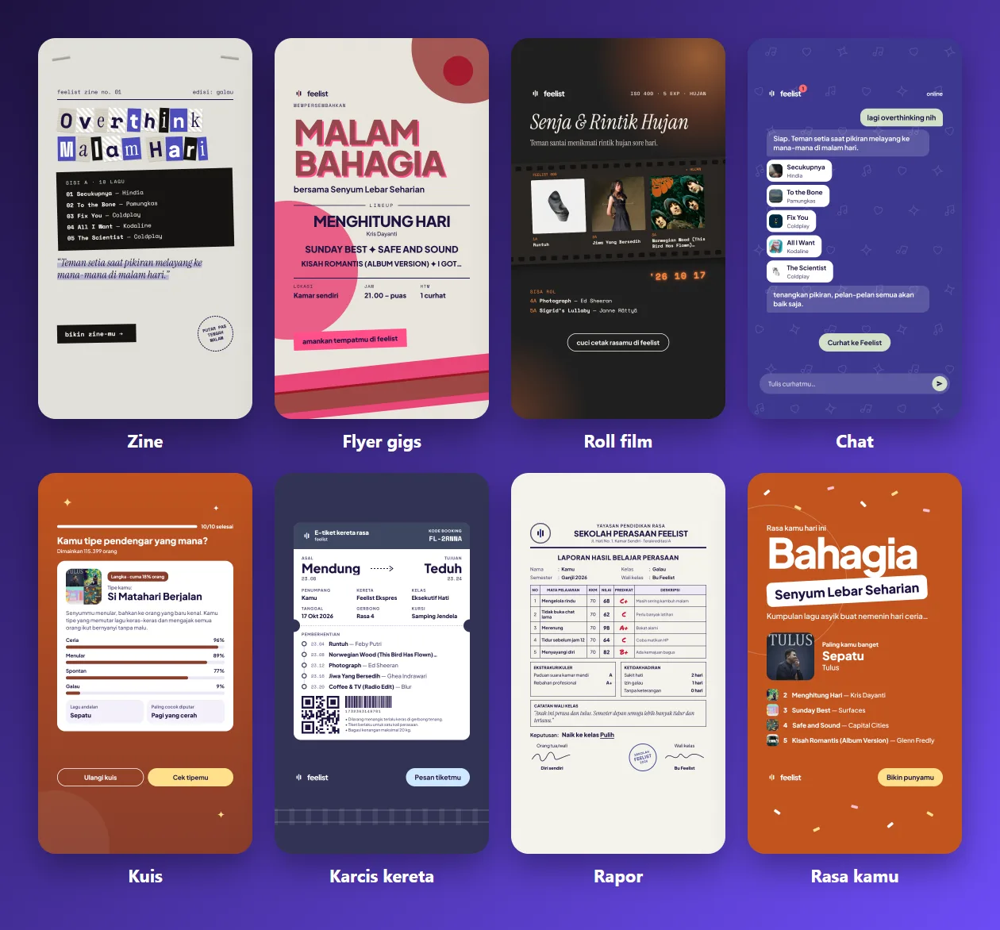
</p>

### Playlist terakhir

<p align="center">
  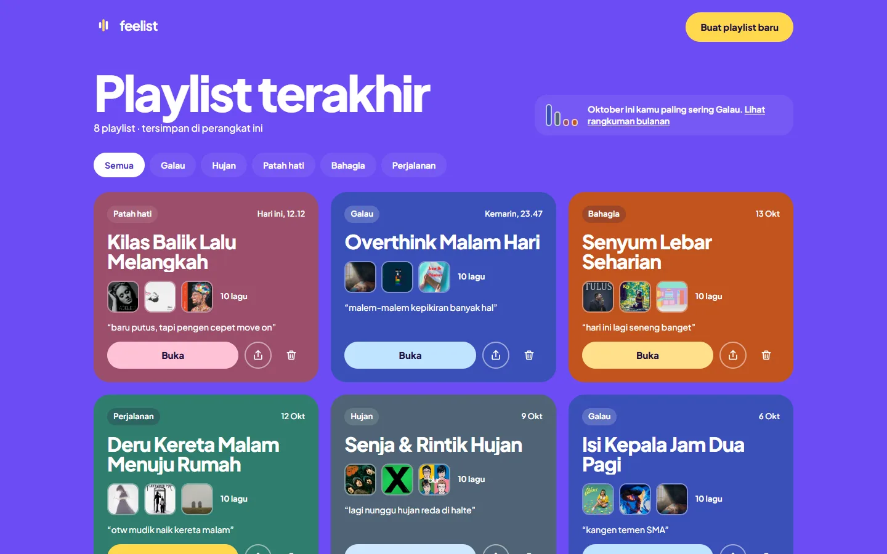
  &nbsp;
  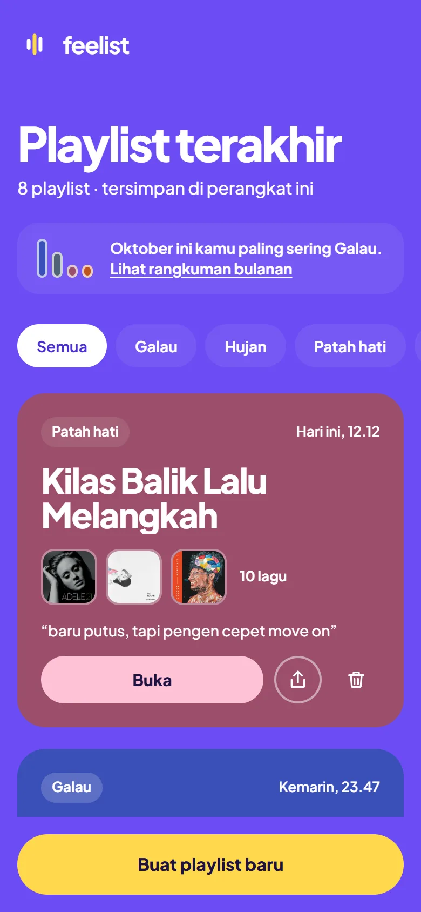
</p>

### Rangkuman bulanan

Edisi Oktober, *"Hujan pertama"*, bertema **Neon malam**: hujan neon, sinar laser, dan teks yang menyala.

<p align="center">
  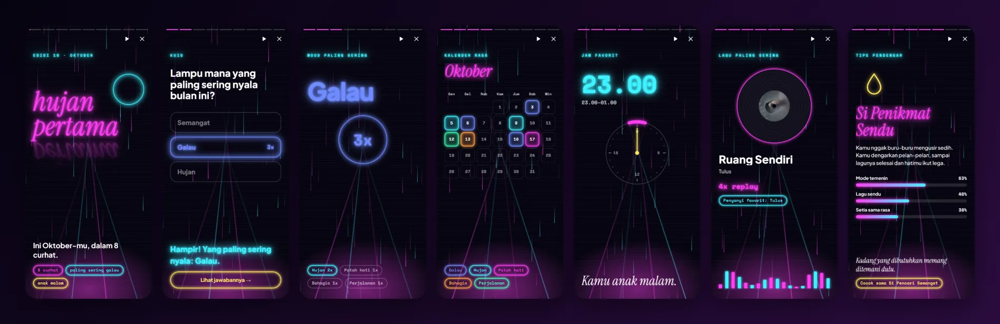
</p>

<p align="center">
  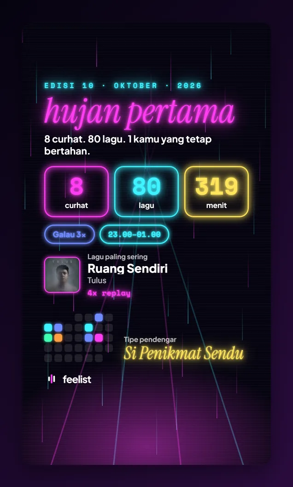
  &nbsp;
  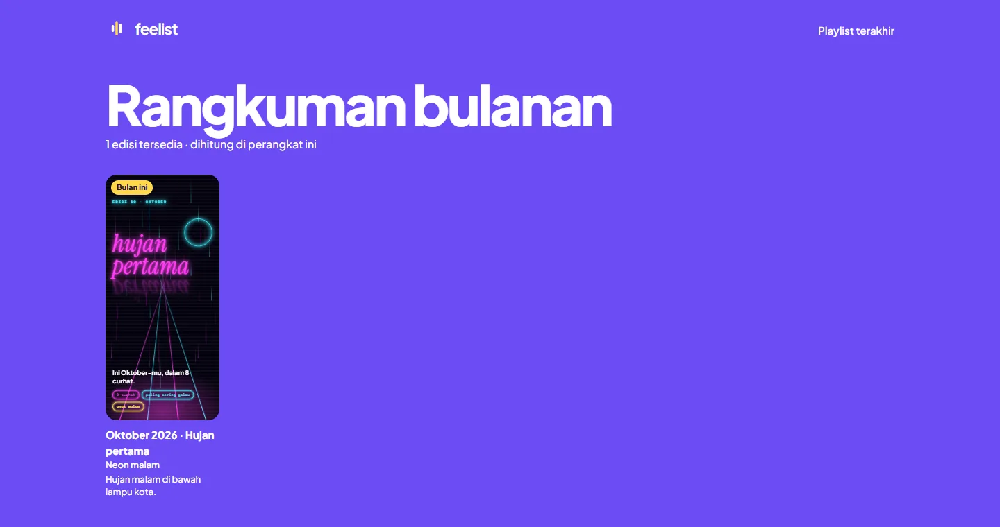
</p>

## 🧩 Fitur

<details open>
<summary><b>Beranda</b></summary>

- Kolom cerita bebas (2–200 karakter) dengan placeholder yang berganti tiap 3 detik, ditambah 3 contoh cerita acak yang bisa diketuk (*"Coba: …"*).
- Chip mood: Galau, Bahagia, Semangat, Hujan, Perjalanan, Patah hati. Klik chip yang sudah terpilih untuk membatalkan. Kalau pengguna tidak memilih mood, AI yang menebak.
- Kalimat interaktif **"Lagu {bahasa} dari era {era}"**: kata kuncinya berupa tombol dengan daftar pilihan (bisa dipakai lewat keyboard), dan pilihan terakhir diingat di perangkat.
- Warna latar dan aksen ikut mood yang dipilih (transisi 0,7 detik), plus satu kalimat arti warnanya.
- Banner **"Rangkuman {bulan} kamu sudah siap"** di tanggal 1–7, kalau rangkuman bulan lalu sudah tersedia.

</details>

<details open>
<summary><b>Halaman hasil & Geser mood</b></summary>

- AI menyusun ±25 lagu (*pool*). Masing-masing punya skor `lift` 1–5 (1 = sangat sendu, 5 = sangat ceria/berenergi).
- **Geser mood**: slider 5 tingkat dengan titik penanda memilih 5–10 lagu dari pool, diurutkan dari sendu ke ceria. Prosesnya sepenuhnya di browser, tanpa memanggil AI atau Deezer lagi. Label slider menyesuaikan mood: *Temenin aku ↔ Hibur aku*, *Santai aja ↔ Makin pecah* (Bahagia), dan *Pemanasan dulu ↔ Gas pol* (Semangat).
- Kalau pool kurang dari 12 lagu, lagu tambahan diminta di latar belakang (`/api/playlist/more`).
- Indikator **MoodWave** di tiap lagu: gelombang sinus yang makin rapat dan tinggi untuk lagu yang makin ceria. Gelombangnya bergerak lebih cepat saat lagunya diputar, dan diam saat `prefers-reduced-motion` aktif.
- Ringkasan *"10 lagu · diurutkan dari sendu ke ceria · 42 menit"* (durasi dari Deezer).
- Klik baris untuk memutar preview 30 detik. Lagu yang sedang diputar menampilkan tombol **Dengerin full** dan **Ganti lagu**. "Ganti lagu" mengambil cadangan dari pool; kalau cadangan habis, minta pengganti ke `/api/replace`.
- **Bar pemutar** 76px selebar layar: tombol sebelumnya / putar / berikutnya mengikuti urutan yang sedang tampil, ada garis progres, dan *Dengerin full*.
- **Dengerin full** membuka pencarian di Spotify atau YouTube Music, dan pilihan terakhir diingat.
- Tombol **Buat ulang** menghasilkan rekomendasi baru dengan mood yang sama, tanpa mengulang lagu lama dan dengan posisi slider dipertahankan.
- Link preview Deezer yang kedaluwarsa otomatis diganti lewat `/api/preview`.

</details>

<details open>
<summary><b>Kartu Story (21 template)</b></summary>

Layar **Pilih gaya kartu** punya tab kategori dengan jumlah template, thumbnail yang dirender dari playlist-mu (hanya tab yang terbuka yang dirender, supaya ringan), label *Paling cocok* / *Terakhir dipakai*, dan navigasi keyboard (panah, Home/End, Enter).

| Kategori | Template |
| --- | --- |
| **Seru** | Rasa kamu · Poster · Tiket · Kolase · Struk · Diputar · Ramalan |
| **Ngobrol** | Chat · Utas · Notifikasi · Kuis |
| **Kalcer** | Zine · Roll film · Flyer gigs · Poster film · Setlist · CD · Mixtape |
| **Lokal** | Karcis kereta · Bukti transfer · Rapor |

Rekomendasi per mood (template pertama langsung terpilih):

| Mood | Rekomendasi |
| --- | --- |
| Galau | Chat · Zine · Rapor |
| Patah hati | Chat · Utas · Mixtape |
| Bahagia | Rasa kamu · Flyer gigs · Kuis |
| Semangat | Rasa kamu · Setlist · Tiket |
| Hujan | Mixtape · Roll film · Zine |
| Perjalanan | Karcis kereta · Roll film · Tiket |
| (tanpa mood) | Rasa kamu · Struk · Notifikasi |

- Kartu 1080×1920 dengan area aman Instagram (250px atas, 96px samping, 340px bawah). Teks dari AI (catatan setlist, hasil kuis, rapor, notifikasi, rute kereta, kalimat utas) punya cadangan per mood.
- Kata tidak pernah terpotong di tengah. Judul panjang mengecil sendiri, dan kata bertanda hubung seperti "apa-apa" tidak dipatahkan.
- Di HP kartu dibagikan lewat lembar berbagi bawaan (Web Share), sedangkan di desktop gambarnya diunduh.
- Font kartu: Plus Jakarta Sans, Space Mono, Instrument Serif, Permanent Marker. Semuanya ikut tertanam di PNG.

</details>

<details open>
<summary><b>Playlist terakhir (<code>/riwayat</code>)</b></summary>

- Maksimal 50 playlist terbaru di IndexedDB (kunci `"riwayat"`); yang paling lama otomatis terhapus.
- Kartu berwarna mood berisi waktu (*"Hari ini, 12.12"*, *"Kemarin, 23.47"*, *"13 Okt"*), 3 cover, jumlah lagu, dan potongan cerita.
- Saringan per mood (hanya mood yang punya playlist), dan kotak ringkasan *"Oktober ini kamu paling sering Galau."*
- **Buka** menampilkan halaman hasil dari data tersimpan (`/hasil?riwayat={id}`) tanpa memanggil AI, termasuk posisi slider. **Bagikan** langsung membuka layar pilih kartu.
- **Hapus** dilengkapi toast *"Urungkan"* selama 5 detik.

</details>

<details open>
<summary><b>Rangkuman bulanan (<code>/rangkuman</code>)</b></summary>

- Dihitung **di perangkat** dari riwayat. Rangkuman muncul kalau ada minimal 3 playlist di bulan itu.
- Pemutar ala Story:
  - progress per slide 7 detik, berhenti saat layar ditahan;
  - ketuk kanan 55% untuk lanjut, kiri 45% untuk kembali;
  - panah kiri/kanan, Esc untuk menutup, dan tombol jeda.
- 9 slide: **cover · angka · kuis · mood · kalender · jam favorit · lagu teratas · tipe pendengar · penutup**. Slide jam dilewati kalau tidak ada jendela favorit, dan slide lagu dilewati kalau lagu teratas muncul kurang dari 2 kali.
- **Tipe pendengar**: Si Penikmat Sendu, Si Pencari Semangat, Si Pengelana, Si Anak Pagi, Si Anak Malam, Si Serba Rasa. Aturan pemilihannya tertulis jelas di `lib/recap/listenerTypes.ts`.
- **12 edisi**, masing-masing dengan judul dan tema tetap:

  | | | | |
  | --- | --- | --- | --- |
  | 01 · Lembar baru · *swiss* | 02 · Kirim rasa · *diary* | 03 · Pancaroba · *riso* | 04 · Mekar pelan · *dreamy* |
  | 05 · Langit panjang · *editorial* | 06 · Musim ujian · *pixel* | 07 · Liburan kecil · *retro70* | 08 · Merdeka rasa · *boldFlat* |
  | 09 · Angin kencang · *brutalist* | 10 · Hujan pertama · **neonMalam** ✅ | 11 · Kabut pagi · *kolaseCover* | 12 · Tutup tahun · *y2k* |

  Baru **Neon malam** yang dibuat lengkap; tema lain sementara memakainya sebagai cadangan.
- Gambar bagikan **1080×1920** statis (`feelist-oktober-2026.png`) berisi angka, mood, lagu teratas, jam, kalender mini, dan tipe pendengar. Cerita pengguna tidak ikut.
- Arsip di `/rangkuman` menampilkan sampul semua edisi yang sudah tersedia.

</details>

<details>
<summary><b>PWA, offline & aksesibilitas</b></summary>

- Service worker [Serwist](https://serwist.pages.dev) menyimpan halaman, aset build, font, ikon, dan cover lagu. Saat offline, playlist lama dan rangkuman tetap bisa dibuka (preview audio tetap butuh internet).
- Bisa di-install ke layar utama HP. Saat dibuka sebagai aplikasi terinstal, zoom pakai jari dimatikan.
- Bisa dipakai penuh dengan keyboard:
  - fokus pindah ke judul setiap ganti layar;
  - semua tombol ikon berlabel;
  - perubahan urutan lagu diumumkan lewat `aria-live`.
- Kontras teks ≥ 4.5:1 di semua warna mood. Hiasan transparan otomatis ditipiskan kalau sampai menurunkan kontras.
- Semua animasi mati saat `prefers-reduced-motion` aktif.
- Getaran halus di HP (`navigator.vibrate`) saat slider melewati titik tengah dan saat playlist jadi.

</details>

## 🔄 Cara kerja

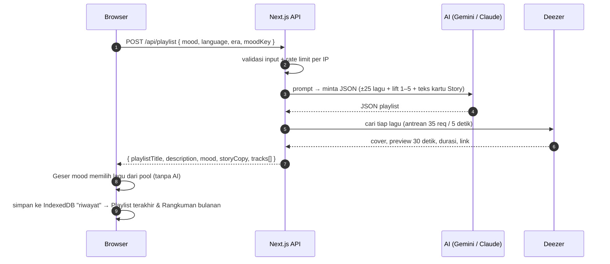

1. AI diminta membalas **hanya JSON**: judul, deskripsi, tebakan mood, ramalan, teks kartu Story, dan ±25 lagu dengan alasan dan `lift`. Jawaban yang rusak ditangani dengan pesan error yang jelas.
2. Setiap lagu dicari ke Deezer dengan query `artist:"…" track:"…"`, lalu query biasa kalau tidak ketemu. Lagu yang tetap tidak ketemu dibuang.
3. Kalau model Gemini utama sibuk atau kuotanya habis, model cadangan dicoba otomatis.
4. Semua lagu yang ketemu menjadi *pool*. Slider Geser mood memilih lagu dari pool di browser (`lib/moodSlider.ts`).

## 🛠️ Tech stack

| Bagian | Teknologi |
| --- | --- |
| Framework | [Next.js 16](https://nextjs.org) (App Router, Cache Components, Turbopack) + React 19 + TypeScript |
| Styling | Tailwind CSS v4 |
| AI | [Google Gen AI SDK](https://www.npmjs.com/package/@google/genai) (default `gemini-3.8-flash`, gratis) · [Anthropic SDK](https://www.npmjs.com/package/@anthropic-ai/sdk) (opsional, `claude-opus-5-5`) |
| Musik | [Deezer API](https://developers.deezer.com/api) publik (tanpa login) |
| Penyimpanan | IndexedDB via [idb-keyval](https://www.npmjs.com/package/idb-keyval) (riwayat), localStorage (pilihan kecil) |
| Gambar | [html-to-image](https://www.npmjs.com/package/html-to-image) (kartu Story & rangkuman → PNG) |
| PWA | [Serwist](https://serwist.pages.dev) (service worker) |
| Font | Plus Jakarta Sans · Space Mono · Instrument Serif · Permanent Marker (`next/font`) |
| Kualitas | ESLint + `eslint-plugin-jsx-a11y` · [Vitest](https://vitest.dev) · axe-core · Lighthouse |

## 🚀 Mulai cepat

### Prasyarat

- Node.js 20.9 atau lebih baru.
- API key Gemini **gratis** dari <https://aistudio.google.com/apikey>. Cukup login akun Google, tanpa kartu kredit.

### 1. Clone & install

```bash
git clone https://github.com/masigoooel/Feelist.git
cd Feelist
npm install
```

### 2. Atur API key

```bash
cp .env.example .env.local
```

```env
AI_PROVIDER=gemini
GEMINI_API_KEY=key-dari-ai-studio
```

| Variabel | Wajib | Keterangan |
| --- | --- | --- |
| `AI_PROVIDER` | tidak | `gemini` (default, gratis) atau `claude` (berbayar) |
| `GEMINI_API_KEY` | ya, kalau pakai Gemini | Key dari Google AI Studio |
| `GEMINI_MODEL` | tidak | Default `gemini-3.8-flash` |
| `GEMINI_FALLBACK_MODELS` | tidak | Model cadangan saat model utama sibuk/kuota habis. Default `gemini-3.6-flash,gemini-3.5-flash-lite` |
| `ANTHROPIC_API_KEY` | ya, kalau pakai Claude | Key dari console Anthropic |
| `ANTHROPIC_MODEL` | tidak | Default `claude-opus-5-5` |

> 🔒 API key hanya dipakai di server (API route), tidak pernah dikirim ke browser. `.env.local` sudah diabaikan git.

### 3. Jalankan

```bash
npm run dev
```

Buka <http://localhost:3000>.

| Perintah | Fungsi |
| --- | --- |
| `npm run dev` | Mode development |
| `npm run build` | Build production |
| `npm start` | Jalankan hasil build (service worker hanya aktif di sini & di Vercel) |
| `npm run lint` | ESLint (termasuk aturan aksesibilitas) |
| `npm test` | Unit test Rangkuman bulanan (Vitest) |

**Coba di HP lewat Wi-Fi yang sama:** jalankan `npm run build && npx next start -H 0.0.0.0`, lalu buka `http://<IP-laptop>:3000` di HP. Di Windows, izinkan port tersebut di firewall untuk jaringan *Private*. Install ke layar utama dan tombol Bagikan butuh HTTPS, jadi paling mudah dicoba lewat hasil deploy Vercel.

## ▲ Deploy ke Vercel

1. Push repo ke GitHub.
2. Di [vercel.com](https://vercel.com) (paket Hobby gratis), pilih **Add New → Project** lalu import repo-nya. Next.js terdeteksi otomatis.
3. Di **Environment Variables**, isi `GEMINI_API_KEY` dan `AI_PROVIDER` (plus variabel lain dari tabel di atas kalau perlu).
4. Klik **Deploy**. Setelah itu setiap push ke `main` otomatis di-deploy ulang.

Atau lewat CLI:

```bash
npx vercel login
npx vercel
npx vercel env add GEMINI_API_KEY
npx vercel --prod
```

Route `/api/playlist` memakai `maxDuration = 60` detik, karena memanggil AI lalu mencari belasan lagu ke Deezer.

## 📁 Struktur folder

```
app/
  page.tsx                     # Beranda → FeelistApp
  hasil/page.tsx               # /hasil?riwayat={id}: halaman hasil dari riwayat (tanpa AI)
  riwayat/page.tsx             # Playlist terakhir
  rangkuman/page.tsx           # Arsip edisi Rangkuman bulanan
  rangkuman/[tahun]/[bulan]/   # Pemutar rangkuman ala Story
  not-found.tsx                # Halaman 404
  layout.tsx · globals.css     # Font, metadata, PWA · token warna & animasi
  sw.ts · serwist/[path]/      # Service worker (Serwist)
  api/
    playlist/route.ts          # POST: validasi → rate limit → AI → Deezer
    playlist/more/route.ts     # POST: lagu tambahan untuk pool Geser mood
    replace/route.ts           # POST: pengganti lagu "Ganti lagu"
    preview/route.ts           # GET: URL preview Deezer baru (link kedaluwarsa)
    image/route.ts             # Proxy cover Deezer (kartu PNG & cache offline)
    feedback/route.ts          # POST: catatan anonim lagu yang diganti
    share-stat/route.ts        # POST/GET: template kartu yang dibagikan (analitik anonim)
components/
  FeelistApp.tsx               # Aplikasi satu halaman: beranda → memuat → hasil → pilih kartu
  SongFilters.tsx              # Kalimat "Lagu {bahasa} dari era {era}"
  TrackList.tsx · TrackCard.tsx · MoodWave.tsx   # Daftar lagu + gelombang suara
  MiniPlayer.tsx · ListenFull.tsx                # Bar pemutar · "Dengerin full"
  ShareCard.tsx                # Layar "Pilih gaya kartu" + ekspor PNG
  HistoryPage.tsx              # Playlist terakhir
  story/templates/*.tsx        # 21 template kartu Story
  recap/                       # Pemutar, banner, arsip & tema Rangkuman bulanan
    themes/neon-malam/         # Tema Neon malam (latar, 9 slide, gambar bagikan)
lib/
  ai.ts · gemini.ts · claude.ts · prompt.ts      # Penyedia AI, prompt & validasi JSON
  deezer.ts · extraSongs.ts                      # Pencarian lagu & antrean kuota Deezer
  moods.ts · moodColors.ts · moodSlider.ts       # Palet mood, kontras, Geser mood
  storyTemplates.ts · storyCopyFallback.ts       # Daftar template & teks cadangan kartu
  playlistStore.ts             # Riwayat di IndexedDB (kunci "riwayat")
  recap/                       # Logika Rangkuman bulanan (+ unit test)
  rate-limit.ts · validate.ts  # Rate limit per IP & validasi request
public/
  manifest.json · icons/ · brand/   # PWA, ikon & logo
docs/screenshots/              # Gambar README
```

## 🎨 Kustomisasi

**Warna mood** ada di satu file, [`lib/moods.ts`](lib/moods.ts):

| Mood | Latar | Aksen | Arti |
| --- | --- | --- | --- |
| (bawaan) | `#6C4CF5` | `#FFD84D` | Ungu, untuk rasa yang belum punya nama. |
| Galau | `#3A4FB8` | `#BFE3FF` | Biru tua, untuk sendu yang bikin kamu banyak merenung. |
| Bahagia | `#C2541F` | `#FFE08A` | Oranye, untuk hangat dan ceria yang pengen dibagi. |
| Semangat | `#C23B4A` | `#FFD84D` | Merah, untuk energi dan berani mulai lagi. |
| Hujan | `#4F6475` | `#CFE8FF` | Abu kebiruan, untuk tenang dan sejuk yang pelan. |
| Perjalanan | `#2F7D6D` | `#FFD84D` | Hijau teal, untuk rasa bebas dan segar di jalan. |
| Patah hati | `#9C4F6B` | `#FFC2D6` | Merah muda pudar, untuk cinta yang lagi terluka. |

- **Template kartu Story baru**: buat komponen di `components/story/templates/`, lalu daftarkan di [`lib/storyTemplates.ts`](lib/storyTemplates.ts) (kategori & rekomendasi per mood) dan [`lib/storyTemplateIds.ts`](lib/storyTemplateIds.ts).
- **Teks rangkuman**: semua kalimat ada di [`lib/recap/copy.ts`](lib/recap/copy.ts).
- **Tema edisi rangkuman baru**: buat folder `components/recap/themes/<nama>/` yang mengekspor `PartialRecapTheme` (palet, font, latar, 9 slide, gambar bagikan, sampul), lalu daftarkan di [`components/recap/themes/index.ts`](components/recap/themes/index.ts). Bagian yang belum dibuat otomatis memakai Neon malam, jadi logika pemutar tidak perlu diubah.

## ✅ Kualitas & pengujian

| Pemeriksaan | Hasil |
| --- | --- |
| Lighthouse (HP, versi produksi) | Performa **98** · Aksesibilitas **100** · Best practices **100**, CLS 0 |
| Aksesibilitas (axe-core, WCAG 2.1 AA) | 0 pelanggaran di semua halaman, HP & desktop |
| Responsif | 7 halaman × 6 ukuran layar (360px – 1920px) tanpa scroll ke samping |
| Kartu Story | 21 template × 3 mood: tidak ada teks tertutup / keluar area aman, kontras ≥ 4.5:1 |
| Unit test (`npm test`) | Rangkuman bulanan: tipe pendengar, jam favorit, slide, privasi |
| TypeScript & ESLint | Bersih (`npx tsc --noEmit`, `npm run lint`) |

## 🔐 Privasi

- **Tanpa login, tanpa database.** Riwayat dan rangkuman hanya ada di IndexedDB perangkat pengguna.
- **Cerita pengguna tidak pernah tampil di kartu Story maupun gambar rangkuman**, dan tidak ikut terkirim saat berbagi. Kode rangkuman bahkan tidak punya akses ke teks cerita: data dipetakan ke `RecapSource` tanpa field cerita sebelum dihitung.
- Catatan "Ganti lagu" (`[feedback]`) dan analitik template (`[share-stat]`) di log server hanya berisi mood, lagu/template, dan waktu, tanpa cerita dan tanpa IP.
- Cerita dikirim ke penyedia AI untuk membuat playlist. Data lewat free tier Gemini **bisa dipakai Google untuk mengembangkan produknya**, jadi jangan masukkan data sensitif.

## 🧯 Batas beban

Supaya kuota gratis (Gemini & Deezer) dan server tidak kewalahan:

| Bagian | Batas |
| --- | --- |
| `/api/playlist` | 8 request/menit per IP |
| `/api/playlist/more`, `/api/replace` | 8 & 12 request/menit per IP |
| Semua route yang memanggil AI | bersama-sama maks. 12 panggilan AI/menit per IP |
| AI berjalan bersamaan | maks. 6 per instance server; lebih dari itu langsung "Lagi ramai banget" (503) |
| Pencarian Deezer | antrean bersama: maks. 35 request / 5 detik & 8 bersamaan (kuota Deezer ±50 / 5 detik) |
| `/api/image` | 600/menit per IP (cover juga di-cache browser, CDN & service worker) |
| `/api/preview` | 60/menit per IP |
| `/api/feedback`, `/api/share-stat` | 30/menit per IP |

Di browser:
- lagu tambahan atau pengganti diminta satu per satu;
- render PNG berjalan berurutan;
- penyimpanan ke IndexedDB ditunda selagi slider digeser;
- warna mood ditulis langsung ke CSS variable, tanpa render ulang React di setiap langkah slider.

Penghitung disimpan di `globalThis`, jadi berlaku lintas route dalam satu proses server. Di Vercel (serverless) tiap instance punya penghitung sendiri, jadi sifatnya *best effort*. Untuk trafik besar, pakai Redis/Upstash.

## 📝 Catatan

- **Preview Deezer** hanya 30 detik dan link-nya punya masa berlaku. Link yang kedaluwarsa diganti otomatis saat diputar.
- **Free tier Gemini** punya batas request per menit dan per hari (lihat AI Studio). Kalau habis, app menampilkan *"Kuota gratis AI lagi habis"*.
- **Pindah ke Claude**: isi `AI_PROVIDER=claude` dan `ANTHROPIC_API_KEY`.
- **Service worker** hanya aktif di mode production. `app/serwist/[path]/route.ts` memakai `generateStaticParams` + `"use cache"` karena route bawaan Serwist tidak kompatibel dengan `cacheComponents`. `app/sw.ts` di-typecheck terpisah: `npx tsc --noEmit -p tsconfig.sw.json`.
- **Rekap template yang dibagikan**: `GET /api/share-stat` (hitungan di memori proses, ter-reset saat server restart).

## 🩺 Troubleshooting

| Masalah | Solusi |
| --- | --- |
| "GEMINI_API_KEY masih berisi contoh dari .env.example" | Ganti `isi-key-gemini-di-sini` dengan key asli, lalu restart `npm run dev`. |
| "Server belum diatur: GEMINI_API_KEY belum diisi" | Pastikan `.env.local` ada dan berisi key, lalu restart. Di Vercel: isi di Environment Variables lalu redeploy. |
| "API key Gemini nggak valid" | Salin ulang key dari AI Studio (tanpa spasi atau tanda kutip). |
| "Kuota gratis AI lagi habis" | Batas free tier tercapai. Tunggu beberapa menit, atau sampai besok kalau kuota harian habis. |
| "Model ... nggak ditemukan" | Ganti `GEMINI_MODEL` dengan model yang ada di <https://ai.google.dev/gemini-api/docs/models>. |
| "Lagunya nggak ada yang ketemu di Deezer" | Coba ubah mood atau longgarkan pilihan (misalnya era "mana aja"). |
| "Pelan-pelan dulu, ya" | Kena rate limit, tunggu sekitar 1 menit. |
| Rangkuman bulanan tidak muncul | Butuh minimal 3 playlist di bulan itu, di perangkat yang sama (riwayat tidak tersinkron antar perangkat). |
| Tombol Bagikan mengunduh gambar | Wajar di desktop atau saat dibuka lewat `http` (non-HTTPS). Lembar berbagi hanya ada di HP dengan HTTPS. |
| Tidak bisa dibuka dari HP di Wi-Fi yang sama | Jalankan dengan `-H 0.0.0.0` dan izinkan port-nya di firewall untuk jaringan *Private*. |

---

<div align="center">

Rekomendasi oleh AI · Cover, preview & durasi lagu dari [Deezer](https://www.deezer.com)

</div>
